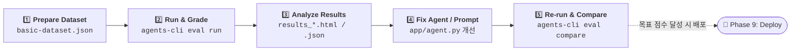
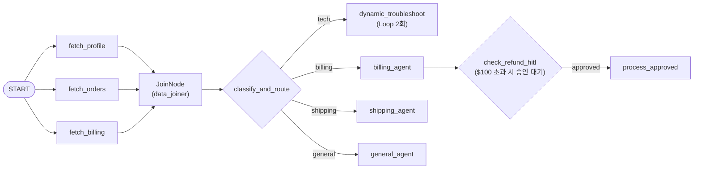

# Agents CLI in Agent Platform

이 실습 가이드는 **Google Agents CLI (`agents-cli`)**와 **Agent Development Kit (ADK)**를 활용하여 AI 에이전트의 **전체 SDLC (Software Development Lifecycle: 프로젝트 생성 → 개발 및 로컬 검증 → 체계적 품질 평가 → 프로덕션 배포 → 관측성 모니터링 → 장기 기억 고도화 → 엔터프라이즈 게시)**를 엔드투엔드로 경험할 수 있도록 구성되어 있습니다.

---

## 🏗️ 에이전트 SDLC (Agent Development Lifecycle) 개요

`agents-cli`는 아이디어를 프로덕션 수준의 에이전트로 전환하기 위한 표준화된 라이프사이클 도구를 제공합니다:

```mermaid
flowchart LR
    subgraph Local ["💻 로컬 개발 및 품질 검증 (Local Loop)"]
        direction LR
        P1["<b>1. Scaffold</b><br/>프로젝트 구조 생성<br/><code>scaffold create</code>"]
        P2["<b>2. Build & Test</b><br/>코드 작성 및 로컬 실행<br/><code>playground</code> / <code>run</code>"]
        P3["<b>3. Evaluate</b><br/>LLM-as-Judge 품질 평가<br/><code>eval run</code> / <code>compare</code>"]
        P1 --> P2 --> P3
        P3 -.->|"Quality Flywheel<br/>(프롬프트·도구 개선)"| P2
    end

    subgraph Cloud ["☁️ 프로덕션 배포 및 운영 (Production Loop)"]
        direction LR
        P4["<b>4. Deploy</b><br/>Agent Runtime 배포<br/><code>scaffold enhance</code> / <code>deploy</code>"]
        P5["<b>5. Observe</b><br/>트레이스·로그 관측<br/>Cloud Trace / Logging"]
        P6["<b>6. Enhance</b><br/>Memory Bank 연동<br/>장기 기억 및 재배포"]
        P7["<b>7. Publish</b><br/>전사 에이전트 등록<br/><code>publish gemini-enterprise</code>"]
        P4 --> P5 --> P6 --> P7
    end

    Local ==>|"품질 기준 통과 시"| Cloud
```



| 단계 (Phase) | 핵심 목표 | 주요 `agents-cli` 명령어 | 본 실습 섹션 |
| :--- | :--- | :--- | :--- |
| **Phase 1: Setup & Scaffold** | CLI 설치 및 대화형 위저드로 ADK 프로젝트 템플릿 생성 | `setup`, `scaffold create --interactive`, `info` | 섹션 1 ~ 4 |
| **Phase 2: Build & Smoke Test** | 에이전트 도구/프롬프트 확인 및 로컬 대화형/CLI 테스트 | `playground`, `run`, `lint` | 섹션 5 ~ 7 |
| **Phase 3: Evaluate (Quality Flywheel)** | 평가 데이터셋 기반 자동 채점 및 개선 전/후 비교 | `eval run`, `eval generate`, `eval grade`, `eval compare` | 섹션 8 |
| **Phase 4: Deploy & Infra** | Agent Runtime 서버리스 배포 (IaC/CI·CD 포함) | `deploy`, `infra` | 섹션 9 |
| **Phase 5: Observe & Monitor** | 원격 호출 검증 및 OpenTelemetry 기반 분산 트레이스/로그 분석 | `run --url` + Cloud Trace / Logging | 섹션 10 |
| **Phase 6: Iterate (Memory Bank)** | 세션 간 장기 기억(Memory Bank) 콜백 추가 및 리비전 재배포 | `deploy` + 멀티 세션 메모리 테스트 | 섹션 11 |
| **Phase 7: Publish** | 배포된 에이전트를 Gemini Enterprise 앱에 도구로 등록 | `publish gemini-enterprise` | 섹션 12 |

---

## 사전 준비 (Before You Begin)
### 1. 환경 변수 설정
1. Google Cloud Console 접속
2. Cloud Shell 접속 (우측 상단)
3. Shell Editor 에서 다음 커맨드 실행
`YOUR_PROJECT_ID` 부분을 본인의 GCP 프로젝트 ID로 변경하여 실행합니다.
```bash
export GOOGLE_CLOUD_PROJECT=[YOUR_PROJECT_ID]
```
```bash
export GOOGLE_CLOUD_LOCATION=global
```

### 2. API 활성화
터미널에서 아래 명령을 실행하여 필요한 Cloud API를 활성화합니다.
```bash
gcloud services enable aiplatform.googleapis.com \
  cloudtrace.googleapis.com \
  cloudbuild.googleapis.com --project ${GOOGLE_CLOUD_PROJECT}
```
검색창에서 "Agent Platform" 검색 후 진입, 상단의 Enable APIs 를 선택해서 관련 API 들을 활성화

---

## 3. Agents CLI 설치 (Install Agents CLI)
[https://google.github.io/agents-cli/](https://google.github.io/agents-cli/)

```bash
uvx google-agents-cli setup
```

#### 설치 확인
```bash
agents-cli --version
# 출력 예시: agents-cli, version 1.3.1
```

---

## 4. 에이전트 프로젝트 생성 (Scaffold)

`agents-cli scaffold create`의 **대화형 모드(`--interactive` / `-i`)**를 사용하여 에이전트 프레임워크, 배포 타겟(`agent_runtime`), CI/CD 옵션, 리전 등을 직접 선택하며 프로젝트를 생성합니다:

### 1. 대화형 모드로 프로젝트 생성
```bash
agents-cli scaffold create customer-support-agent --interactive
```

대화형 프롬프트가 나타나면 아래 순서대로 선택합니다:
1. **Template 선택**: `1` (**`adk`** - Python ADK 기본 에이전트 템플릿)
2. **Deployment Target 선택**: `1` (**`agent_runtime`** - Vertex AI Agent Runtime 관리형 배포 환경)
3. **CI/CD Runner 선택**: `1` (**`skip`** - 본 실습에서는 직접 CLI로 배포하므로 생략하거나 원하는 러너 선택)
4. **GCP Region 입력**: `us-central1` 입력 후 Enter
5. **GCP Credentials / Project 확인**: 현재 연결된 프로젝트 확인 후 진행

> 💡 **(참고) 플래그를 통한 비대화형 즉시 생성**:
> 위 대화형 선택 과정을 한 줄의 명령어로 즉시 실행하려면 아래와 같이 플래그를 전달하거나, 프로토타입 모드(`--prototype --yes`)를 사용할 수도 있습니다:
> ```bash
> # 배포 타겟(agent_runtime)까지 한 번에 지정하여 생성
> agents-cli scaffold create customer-support-agent --agent adk --deployment-target agent_runtime --region us-central1 --yes
> ```

### 2. 생성된 폴더 구조 및 `agent_runtime` 설정 확인
생성된 디렉토리로 이동하여 파일 구조와 매니페스트에 `agent_runtime` 배포 타겟이 정상 반영되었는지 확인합니다 ([프로젝트 구조 가이드](https://google.github.io/agents-cli/guide/project-structure/)):

```bash
cd customer-support-agent
ls -al
```

`agents-cli info` 명령어 또는 `agents-cli-manifest.yaml` 파일을 조회하여 `deployment_target: agent_runtime`으로 설정되었는지 확인합니다:
```bash
# CLI로 현재 프로젝트 설정 요약 확인
agents-cli info

# 또는 매니페스트 파일 직접 확인
cat agents-cli-manifest.yaml
```

> 💡 **스캐폴딩으로 생성되는 핵심 파일**:
> - `agents-cli-manifest.yaml`: 선택한 템플릿(`adk`), 배포 타겟(`agent_runtime`), 리전(`us-central1`) 등이 기록된 프로젝트 매니페스트
> - `app/agent.py`: ADK 에이전트(`root_agent`) 및 도구(Tools) 정의
> - `app/agent_runtime_app.py`: Agent Runtime 배포를 위한 서버리스 엔트리포인트 래퍼
> - `tests/eval/`: 에이전트 품질 평가를 위한 데이터셋(`datasets/`)과 평가 설정(`eval_config.yaml`)

---

## 5. Cloud Shell Editor 를 통해 코드 확인 및 정적 검증 (Build)
Cloud Shell 의 우측 상단에서 **Open Editor** 선택 후 `/app/agent.py` 코드를 확인합니다.

- 기본 생성된 `root_agent`는 날씨를 조회하는 `get_weather`와 현재 시각을 조회하는 `get_current_time` 두 개의 도구를 가지고 있습니다.
- 코드 수정 후 문법 오류나 스타일 이슈가 없는지 CLI로 빠르게 검증할 수 있습니다:
```bash
# 코드 린트(Lint) 및 포맷 검사
agents-cli lint
```

---

## 6. 로컬 테스트 - 대화형 GUI 로 기본 에이전트 테스트 (Local Playground)

로컬 환경에서 대화형 웹 UI(Playground)를 실행하고, 스캐폴딩으로 기본 생성된 에이전트(`get_weather`, `get_current_time`)의 동작을 먼저 확인합니다.

```bash
agents-cli playground
```

샘플 질문 테스트:
  - `"What's the weather in San Francisco?"`
  - `"도쿄의 날씨는 어때?"`
  - `"What time is it in San Francisco?"`
  - `"서울의 날씨와 현재 시간을 알려주세요"` *(기본 코드에서는 샌프란시스코 외 시간대 조회가 제한되어 있는 것을 확인할 수 있습니다)*

---

## 7. 고객센터 에이전트 코드 적용 및 CLI Smoke Test (Build & Smoke Test)

기본 생성된 샘플 코드를 확인했으니, 이제 프로젝트 이름(`customer-support-agent`)에 걸맞은 **온라인 스토어 고객센터 에이전트 코드**로 업그레이드하고 터미널에서 빠르게 스모크 테스트(Smoke Test)를 수행합니다.

### 1. 고객센터 에이전트 코드(`agent.py`) 복사 및 적용

제공된 [`agent.py`](agent.py) 파일에는 다음 3가지 핵심 도구(Tools)가 구현되어 있습니다:
- **`get_order_status(order_id)`**: 주문 번호(`ORD-1001`, `ORD-1002`)로 배송 상태, 품목, 결제 금액 조회 *(정적 응답 — 평가 시 Reference-based 채점용)*
- **`get_refund_policy(category)`**: 상품 카테고리(`electronics`, `apparel`, `digital`)별 환불 규정 안내 *(정적 응답 — 평가 시 Reference-based 채점용)*
- **`create_support_ticket(customer_name, issue_summary)`**: 상담 티켓 번호(`TKT-시분초`) 및 현재 접수 시각 발급 *(동적 응답 — 평가 시 Reference-free 채점용)*

터미널에서 [`agent.py`](agent.py) 파일을 프로젝트의 `app/agent.py` 위치로 복사하고 문법을 검증합니다:

```bash
# 준비된 고객센터 에이전트 코드를 app/agent.py로 복사
cp ../agent.py ./app/agent.py

# 코드 린트(Lint) 검사
agents-cli lint
```

### 2. CLI로 에이전트 스모크 테스트 (`agents-cli run`)

웹 브라우저를 켜지 않고 터미널에서 변경된 에이전트의 각 도구가 정상적으로 호출되는지 빠르게 테스트합니다:

```bash
# 1) 주문 배송 조회 도구(get_order_status) 호출 테스트
agents-cli run "Can you check the status of my order ORD-1001?"

# 2) 환불 규정 조회 도구(get_refund_policy) 호출 테스트
agents-cli run "What is the refund policy for electronics?"

# 3) 상담 티켓 생성 도구(create_support_ticket) 호출 테스트
agents-cli run "My name is Alice. My laptop screen arrived cracked, please open a support ticket."
```

> 💡 **디버깅 팁**: `-v` (`--verbose`) 플래그를 추가하면 LLM과 주고받는 전체 JSON 이벤트 페이로드(중간 도구 호출 인자, 응답 등)를 상세히 확인할 수 있습니다. 여러 번 반복 테스트할 때는 `--start-server` 옵션으로 로컬 서버를 유지하면 실행 속도가 빨라집니다.

### 실행 결과 예시
```text
[user]: Can you check the status of my order ORD-1001?
[root_agent]:
[tool_call: get_order_status({"order_id": "ORD-1001"})]
[tool_response: get_order_status -> {"order_id": "ORD-1001", "customer": "Alice", "item": "Pro Laptop 16-inch", "status": "In Transit", "estimated_delivery": "2026-11-02", "carrier": "FedEx", "amount": "$1,800"}]
Your order ORD-1001 (Pro Laptop 16-inch) is currently In Transit via FedEx, with an estimated delivery date of 2026-11-02.

Session: fb30f7f7-147e-4697-8aaa-706d604589fa (resume with --session-id)
```

---

## 8. 에이전트 평가 (Evaluate Your Agent - Quality Flywheel)

LLM 출력은 비결정적(Non-deterministic)이므로 단순 `pytest`만으로는 에이전트의 응답 품질이나 도구 선택 정확도를 검증할 수 없습니다. Agents CLI의 평가(Evaluation) 워크플로우는 **데이터셋 정의 → 에이전트 추론 실행(`eval generate`) → LLM-as-judge 기반 자동 채점(`eval grade`) → 코드/프롬프트 개선 후 점수 비교(`eval compare`)**의 **Quality Flywheel** 루프로 구성됩니다.



### 평가 디렉토리 구조 (`tests/eval/`)
- `tests/eval/datasets/basic-dataset.json`: 평가용 데이터셋 (JSON 형식)
- `tests/eval/eval_config.yaml`: 평가 메트릭(`metrics_to_run`) 및 커스텀 평가기(`custom_metrics`) 설정
- `tests/eval/response_quality.py`: LLM-as-judge 기반 응답 품질 채점 로직 (Score 1~5점)

### 1. 평가 데이터셋 수정 (`tests/eval/datasets/basic-dataset.json`)
`tests/eval/datasets/basic-dataset.json` 파일을 편집하여 고객센터 에이전트의 테스트 케이스 및 기대 응답(`reference`)을 작성합니다:

```json
{
  "eval_cases": [
    {
      "eval_case_id": "order_status_lookup",
      "prompt": {
        "role": "user",
        "parts": [{"text": "What is the shipping status of order ORD-1001?"}]
      },
      "reference": {
        "response": {
          "role": "model",
          "parts": [{"text": "Order ORD-1001 for the Pro Laptop 16-inch is currently In Transit via FedEx, with an estimated delivery date of 2026-11-02."}]
        }
      }
    },
    {
      "eval_case_id": "refund_policy_electronics",
      "prompt": {
        "role": "user",
        "parts": [{"text": "What is the refund policy for electronics?"}]
      },
      "reference": {
        "response": {
          "role": "model",
          "parts": [{"text": "Electronics can be returned within 30 days of delivery in original packaging. A 10% restocking fee applies if opened."}]
        }
      }
    },
    {
      "eval_case_id": "create_ticket_request",
      "prompt": {
        "role": "user",
        "parts": [{"text": "My name is Alice and my package arrived damaged. Please create a support ticket for me."}]
      }
    }
  ]
}
```

> 💡 **왜 어떤 항목에는 `reference`(모범 답안)가 있고, 어떤 항목에는 없을까요?**
> - **`reference`가 있는 케이스 (`order_status_lookup`, `refund_policy_electronics`) — 정답이 고정된 정적 질문**:
>   `get_order_status`와 `get_refund_policy` 도구는 언제 호출하든 고정된 주문 정보(`In Transit`, `FedEx`, `2026-11-02`)와 환불 규정(`30 days`, `10% restocking fee`)을 반환합니다. 이처럼 기대하는 정답(Golden Answer)이 명확할 때는 `reference.response`를 명시하여 에이전트의 답변이 모범 답안의 핵심 팩트와 일치하는지(**Reference-based**) 채점합니다.
> - **`reference`가 없는 케이스 (`create_ticket_request`) — 실행할 때마다 정답이 바뀌는 동적 질문**:
>   `create_support_ticket` 도구는 실행 시점의 현재 시각(`datetime.now()`)을 기반으로 매번 다른 티켓 번호(`TKT-시분초`)와 생성 시각을 반환하므로 고정된 정답을 미리 적어둘 수 없습니다. 이처럼 `reference`를 생략하면 LLM 평가자(LLM-as-Judge)가 고정된 정답과 비교하는 대신, 에이전트의 실행 트레이스(`agent_data`)를 보고 **① 올바른 도구(`create_support_ticket`)를 호출했는지**, **② 도구가 반환한 티켓 번호를 왜곡(Hallucination) 없이 답변했는지**, **③ 질문 의도를 달성했는지**(**Reference-free**)를 기준으로 채점합니다.

### 2. 평가 설정 확인 (`tests/eval/eval_config.yaml`)
`eval_config.yaml`은 크게 두 부분으로 구성됩니다:
1. **`metrics_to_run`**: 이번 평가에서 **실제로 실행할 메트릭 선택 목록**입니다. 플랫폼이 기본 제공하는 **빌트인(Built-in) 메트릭**은 아래 `custom_metrics`에 따로 정의할 필요 없이 여기에 이름만 적으면 즉시 실행됩니다.
2. **`custom_metrics`**: 프로젝트만의 **커스텀 메트릭 정의 풀(Pool)**입니다. 여기에 정의해 두었더라도 위 `metrics_to_run`에 이름을 올리지 않으면 실행되지 않습니다.

> 💡 사용 가능한 전체 빌트인 평가 메트릭 목록은 `agents-cli eval metric list` 명령어로 조회할 수 있습니다.

`tests/eval/eval_config.yaml` 파일을 아래와 같이 구성하여 빌트인 메트릭과 커스텀 메트릭을 함께 실행할 수 있습니다:

```yaml
# 1. 실제로 실행할 메트릭 목록 (빌트인 + 커스텀 모두 여기에 이름을 적어야 실행됨!)
metrics_to_run:
  # --- 기본 제공(Built-in) 메트릭: 아래 custom_metrics에 정의할 필요 없이 이름만 적으면 끝! ---
  - final_response_quality        # 최종 답변 품질 평가 (빌트인)
  - multi_turn_tool_use_quality   # 도구(Tool) 선택 및 호출 정확도 평가 (빌트인)
  - safety                        # 안전성 가이드라인 준수 여부 (빌트인)

  # --- 커스텀(Custom) 메트릭: 아래 custom_metrics에 정의된 이름과 매칭되어 실행됨 ---
  - custom_response_quality
  - agent_turn_count

# 2. 커스텀 메트릭 정의 풀 (빌트인 메트릭은 여기에 적지 않음)
custom_metrics:
  - name: custom_response_quality   # 메트릭 정의코드(response_quality.py)를 외부 분리
    custom_function_file: response_quality.py
  - name: agent_turn_count # "에이전트가 사용자의 질문에 최종 답변을 하기까지 몇 턴(Turn)이 걸렸는가?"
    custom_function: |
      def evaluate(instance):
          turns = (instance.get("agent_data") or {}).get("turns", [])
          return {'score': len(turns)}
```

#### 🔍 `custom_metrics`의 두 항목 상세 설명

스캐폴딩 시 기본 제공되는 두 가지 커스텀 메트릭은 각각 **외부 파일 기반 LLM-as-Judge 평가**와 **인라인 함수 기반 정량(Deterministic) 평가**의 대표적인 패턴을 보여줍니다:

| 커스텀 메트릭 이름 | 선언 방식 | 동작 원리 및 역할 |
| :--- | :--- | :--- |
| **`custom_response_quality`** | `custom_function_file: response_quality.py`<br/>*(외부 Python 파일 참조)* | **로컬 LLM-as-Judge 채점기 (1~5점)**<br/>• `tests/eval/response_quality.py` 파일의 `evaluate(instance)` 함수를 실행합니다.<br/>• 내부에서 `google-genai` SDK로 Gemini 모델(`temperature=0`, Structured Output)을 호출하여 **질문(`prompt`), 에이전트 답변(`response`), 전체 실행 트레이스(`agent_data`)**를 종합 평가합니다.<br/>• 데이터셋에 **`reference`(모범 답안)가 있으면** 팩트 일치 여부를 엄격히 채점하고, **`reference`가 없으면** 정확성·관련성·명확성을 기준으로 1~5점(`score`)과 채점 이유(`explanation`)를 반환합니다. |
| **`agent_turn_count`** | `custom_function: \| ...`<br/>*(YAML 내 인라인 Python 코드)* | **코드 기반 정량 측정기 (턴 수 카운트)**<br/>• LLM을 호출하지 않고 순수 Python 코드로 즉시 계산하는 결정론적(Deterministic) 메트릭입니다.<br/>• 에이전트 실행 트레이스(`instance["agent_data"]["turns"]`)의 길이를 세어, **에이전트가 최종 답변을 내기까지 몇 턴(Turn)이 걸렸는지**를 점수(`score`)로 반환합니다.<br/>• 에이전트가 불필요하게 도구를 반복 호출하거나 루프에 빠지지 않고 효율적으로 답변했는지 확인할 때 유용합니다. |

### 3. 평가 실행 (Evaluation Run)

**옵션 1: 추론 및 채점 일괄 실행 (권장)**
데이터셋을 기반으로 에이전트를 실행하고 트레이스를 채점하는 과정을 한 번에 수행합니다:
```bash
agents-cli eval run
```

**옵션 2: 2단계 분리 실행 (`generate` + `grade`)**
```bash
# 1단계: 평가 데이터셋 기반 에이전트 추론 실행 및 트레이스 생성 (artifacts/traces/ 에 저장)
agents-cli eval generate

# 2단계: 생성된 트레이스 및 응답 채점 (LLM-as-judge)
agents-cli eval grade
```

> 💡 **(심화) 멀티턴 시뮬레이션 데이터셋 자동 생성**:
> 직접 테스트 케이스를 작성하기 어려운 경우, 에이전트의 도구와 지시사항(Instruction)을 분석해 LLM 사용자 시뮬레이터와 자동으로 대화하며 트레이스를 생성하는 `agents-cli eval dataset synthesize` 명령어를 활용할 수도 있습니다.

### 4. 평가 결과 확인 및 전/후 비교 (`eval compare`)
`agents-cli eval run` (또는 `eval grade`)을 실행할 때마다 `artifacts/grade_results/` 폴더에 타임스탬프가 찍힌 결과 파일(`results_<YYYYMMDD_HHMMSS>.json` 및 `.html`)이 누적 저장됩니다.

1. **생성된 평가 결과 파일 목록 확인**:
   ```bash
   ls -lt artifacts/grade_results/
   ```
   - 터미널에 출력된 요약 테이블 외에도 `.html` 파일을 열면 각 케이스별 점수(Score)와 LLM 평가자의 상세 채점 근거(Explanation)를 시각적으로 확인할 수 있습니다.

2. **여러 번 평가 수행 후 전/후 결과 비교 (`eval compare`)**:
   - 에이전트의 프롬프트(`instruction`), 도구 로직, 또는 모델을 수정한 뒤 `agents-cli eval run`을 한 번 더 실행합니다.
   - 이전 실행 결과(Baseline)와 새 실행 결과(Candidate) 두 JSON 파일을 비교하여, 목표했던 케이스의 점수가 향상되었는지(`+`) 그리고 기존에 잘 동작하던 케이스에서 점수 하락(회귀, Regression)이 발생하지 않았는지(`-`) 한눈에 검증합니다:
   ```bash
   # 예시: 1차 평가 결과와 2차 평가 결과 비교
   agents-cli eval compare \
     artifacts/grade_results/results_20261029_071000.json \
     artifacts/grade_results/results_20261029_071500.json
   ```

---

## 9. Agent Runtime 배포 (Deploy to Production)

평가를 통해 에이전트 품질이 검증되었으면, Google Cloud의 서버리스 관리형 환경인 **Agent Runtime**에 에이전트를 배포합니다.

### 1. `.env` 파일 설정 추가 (Telemetry for ADK)
배포된 에이전트의 실행 흐름과 이벤트를 Cloud Trace 및 Cloud Logging에서 관측할 수 있도록 `.env` 파일에 OpenTelemetry 설정을 추가합니다:
```bash
cat << 'EOF' >> .env
# Telemetry for ADK
GOOGLE_CLOUD_AGENT_ENGINE_ENABLE_TELEMETRY=true
OTEL_SEMCONV_STABILITY_OPT_IN="gen_ai_latest_experimental"
OTEL_INSTRUMENTATION_GENAI_CAPTURE_MESSAGE_CONTENT=EVENT_ONLY
EOF
```

### 2. `.env` 파일 확인
설정이 정상적으로 반영되었는지 확인합니다:
```bash
cat .env
```

### 3. 배포 실행

```bash
agents-cli deploy --project $GOOGLE_CLOUD_PROJECT --region us-central1
```

> ⏱️ 최초 배포에는 약 **5~10분**이 소요됩니다. (이후 재배포는 더 빠르게 진행됩니다.)
>
> 💡 **(참고) 엔터프라이즈 IaC 및 CI/CD 파이프라인 구성**:
> 실무 프로덕션 환경에서는 수동 배포 대신 Terraform 기반 인프라 프로비저닝(`agents-cli infra single-project`) 및 GitHub Actions / Cloud Build 기반 자동화 파이프라인(`agents-cli infra cicd`) 명령어를 통해 GitOps 기반 SDLC를 구축할 수 있습니다.

#### 완료 결과 출력 예시
```text
✅ Deployment successful!
Agent Runtime ID: projects/.../locations/us-central1/reasoningEngines/XXXXXXXXXXXXXXXXXX
Service Account: service-XXXXXXXXX@gcp-sa-aiplatform-re.iam.gserviceaccount.com

📊 Open Console Playground: https://console.cloud.google.com/vertex-ai/agents/agent-engines/locations/us-central1/agent-engines/XXXXXXXXXXXXXXXXXX/playground?project=YOUR_PROJECT_ID

📊 View in Console: https://console.cloud.google.com/vertex-ai/agents/agent-engines/locations/us-central1/agent-engines/7453835065542311936?project=qwiklabs-gcp-02-9d3068d766d7
```

---

## 10. 배포된 에이전트 테스트 및 관측성 모니터링 (Test & Observe in Production)

프로덕션에 배포된 에이전트에 트래픽을 발생시키고, 앞서 활성화한 OpenTelemetry 텔레메트리를 통해 **분산 트레이스(Trace)**와 **로그(Log)**를 모니터링합니다.

### 1. 배포 에이전트 호출 테스트

#### 옵션 1: Console Playground (가장 쉬운 방법)
- 배포 완료 메시지에 출력된 Google Cloud Console 링크(`Open Console Playground` 또는 `View in Console`)를 클릭하여 Agent Platform에 진입합니다.
- **Playground** 탭에서 대화를 통해 배포된 에이전트를 테스트합니다.

#### 옵션 2: `agents-cli run --url` (원격 CLI 호출)
터미널에서 `deployment_metadata.json`에 기록된 원격 배포 엔드포인트로 직접 쿼리를 전송합니다:
```bash
RUNTIME_ID=$(jq -r .remote_agent_runtime_id deployment_metadata.json)

agents-cli run \
  --url "https://us-central1-aiplatform.googleapis.com/v1/${RUNTIME_ID}" \
  --mode adk \
  "Can you check the status of my order ORD-1001?"
```

### 2. 관측성 및 모니터링 확인 (Observability)

에이전트 호출 후 Google Cloud의 관측성 도구에서 내부 추론 과정과 성능을 분석합니다:

1. **Cloud Trace (분산 트레이싱 & 지연 시간 분석)**
   - Google Cloud Console에서 **[Trace Explorer](https://console.cloud.google.com/traces/list)** 또는 Agent Engine 상세 페이지의 **Traces** 탭으로 이동합니다.
   - 아래와 같은 ADK OpenTelemetry 스팬(Span) 계층 구조를 통해 어느 단계에서 시간이 소요되었는지 확인합니다:
     ```text
     invoke_workflow (전체 실행)
       └── invoke_agent (root_agent 실행)
             ├── call_llm (Gemini 모델 추론 요청)
             │     └── generate_content
             └── execute_tool (get_order_status 도구 실행)
     ```
2. **Cloud Logging (이벤트 및 프롬프트·응답 로그)**
   - **[Logs Explorer](https://console.cloud.google.com/logs/query)**에서 아래 쿼리로 에이전트 런타임 로그 및 `EVENT_ONLY`로 캡처된 입출력 이벤트를 확인합니다:
     ```text
     resource.type="aiplatform.googleapis.com/ReasoningEngine"
     ```
3. **Cloud Monitoring (메트릭 모니터링)**
   - Agent Engine 대시보드에서 요청 수(`request_count`), 응답 지연 시간(`request_latencies`), 컨테이너 인스턴스 수 등을 모니터링합니다.

---

## 11. 기능 고도화 및 재배포: Memory Bank 활성화 (Continuous Iteration)

단발성 세션을 넘어, 사용자가 이전 대화에서 언급한 정보(이름, 주문 번호, 관심 카테고리 등)를 장기 기억(Long-term Memory)으로 저장하고 다음 세션에서 활용하도록 **Memory Bank**를 연동한 뒤 새 리비전(Revision)으로 재배포합니다.

### 1. Memory Bank가 적용된 코드(`agent_memory.py`) 복사 및 확인
제공된 [`agent_memory.py`](agent_memory.py) 파일에는 기존 고객센터 에이전트 코드에 다음 두 가지가 추가되어 있습니다:
- **`preload_memory` 도구**: 에이전트가 매 턴 시작 시 Memory Bank에서 사용자 관련 기억을 검색하여 컨텍스트에 주입합니다.
- **`add_session_to_memory_callback` (`after_agent_callback`)**: 에이전트 추론이 끝난 후 현재 세션의 대화 내용을 Memory Bank에 저장합니다.

터미널에서 [`agent_memory.py`](agent_memory.py)를 `app/agent.py`로 복사합니다:
```bash
# Memory Bank 콜백과 preload_memory 도구가 추가된 코드를 app/agent.py로 복사
cp ../agent_memory.py ./app/agent.py
```

<details>
<summary>📄 <b>변경된 핵심 코드 확인하기 (클릭하여 펼치기)</b></summary>

```python
from google.adk.agents.callback_context import CallbackContext
from google.adk.tools import preload_memory

### Memory Bank 사용을 위한 콜백 함수 추가
async def add_session_to_memory_callback(callback_context: CallbackContext):
    # Session 내의 정보들을 Memory Bank에 저장
    await callback_context.add_session_to_memory()
    return None

root_agent = Agent(
    name="root_agent",
    model=Gemini(
        model=MODEL,
        retry_options=types.HttpRetryOptions(attempts=3),
    ),
    instruction=SYSTEM_INSTRUCTION,
    ### preload_memory : 에이전트가 매 턴 시작 시 메모리를 검색하고 시스템 메시지로 주입
    tools=[get_order_status, get_refund_policy, create_support_ticket, preload_memory],
    ### after_agent_callback: 에이전트 추론 완료 후 세션 메모리를 저장
    after_agent_callback=add_session_to_memory_callback,
)
```
</details>

### 2. 코드 변경 사항 재배포 (In-Place Update)
```bash
agents-cli deploy --project $GOOGLE_CLOUD_PROJECT --region us-central1
```
- `agents-cli deploy`는 동일한 에이전트 이름을 감지하여 새 Reasoning Engine을 중복 생성하지 않고 기존 인스턴스를 **In-place 업데이트**합니다.
- Cloud Console의 Agent Engine 상세 페이지 **Revisions** 탭에서 새 리비전이 배포된 것을 확인하고, **Memories** 탭이 활성화된 것을 확인합니다.

### 3. Memory Bank 동작 검증 (멀티 세션 테스트)
Console Playground에서 두 번의 독립된 세션을 통해 장기 기억이 유지되는지 테스트합니다:
1. **첫 번째 세션 (기억 저장)**:
   - 질문 입력: `"Hi! My name is Alice, and my active order ID is ORD-1001."`
   - 에이전트가 응답을 완료하면 `after_agent_callback`(`add_session_to_memory_callback`)이 호출되어 대화 내용이 Memory Bank에 비동기로 추출·저장됩니다.
2. **두 번째 세션 (새 세션 시작 & 기억 인출)**:
   - Playground에서 **새 세션(New Session / Reset)**을 시작합니다.
   - 질문 입력: `"What is my name, and where is my order right now?"` *(주문 번호를 말하지 않고 질문)*
   - `preload_memory` 도구가 매 턴 시작 시 이전 세션의 메모리를 조회하여 고객 이름(`"Alice"`)과 주문 번호(`"ORD-1001"`)를 기억해내고, 즉시 `get_order_status("ORD-1001")`를 호출하여 배송 상태(`In Transit via FedEx`)를 답변하는 것을 확인합니다!

---

## 12. Gemini Enterprise에 게시 (Publish to Gemini Enterprise)

### 1. Gemini Enterprise app 생성
검색창에서 Gemini Enterprise 를 검색해서 Gemini Enterprise 에 진입합니다.
Create your first app 을 통해 app 을 생성 합니다.

### 2. 대상 앱 목록 조회
```bash
agents-cli publish gemini-enterprise --list
# {"apps": [{"display_name": "gemini-enterprise-1790830998347", "location": "global", "name": "projects/399682065156/locations/global/collections/default_collection/engines/gemini-enterprise-17908309_1790830998347"}]}
```

### 3. 에이전트 등록
```bash
# agents-cli publish gemini-enterprise --list 명령어의 결과를 아래 환경변수에 등록 ("projects/399682065156/locations/global/collections/default_collection/engines/gemini-enterprise-17908309_1790830998347")
export GE_APP_ID=[YOUR_GE_APP_ID]

agents-cli publish gemini-enterprise \
  --gemini-enterprise-app-id "${GE_APP_ID}" \
  --display-name "Customer Support Agent" \
  --description "Checks order status, explains refund policies, and creates support tickets" \
  --tool-description "Use this tool to ask the customer support agent about orders, refunds, or support tickets."
```

#### 완료 결과 출력 예시
```text
✅ Successfully created agent registration!
   Agent Name:
   projects/399682065156/locations/global/collections/default_collection/engines/gemini-enterprise-17908309_1790830998347/assistants/default_assistant/agents/5818257743899995143

🔗 View in Console:
   https://console.cloud.google.com/gemini-enterprise/locations/global/engines/gemini-enterprise-17908309_1790830998347/overview/dashboard?project=qwiklabs-gcp-02-9d3068d766d7
{"status": "ok", "action": "created", "registration_type": "adk", "agent_name": "projects/399682065156/locations/global/collections/default_collection/engines/gemini-enterprise-17908309_1790830998347/assistants/default_assistant/agents/5818257743899995143", "gemini_enterprise_app_id": "projects/399682065156/locations/global/collections/default_collection/engines/gemini-enterprise-17908309_1790830998347", "console_url": "https://console.cloud.google.com/gemini-enterprise/locations/global/engines/gemini-enterprise-17908309_1790830998347/overview/dashboard?project=qwiklabs-gcp-02-9d3068d766d7"}
```

### 4. Gemini Enterprise 에서 배포한 에이전트 실행
- 배포 완료 메시지에 출력된 Google Cloud Console 링크(View in Console)를 클릭
- Preview 버튼을 클릭하여 Gemini Enterprise 진입
- 방법1) "@Customer Support Agent" 태그 이후 프롬프트 입력하여 Agent 호출
- 방법2) 좌측 Agents 에서 "Customer Support Agent" 선택 후 프롬프트 입력


--

# (선택사항) Graph Workflow

앞선 기본 실습(1~12번)에서는 단일 `Agent`(`LlmAgent`)에게 여러 도구를 주고 LLM이 자율적으로 판단하게 했다면, 이번 심화 과정에서는 ADK의 **`Workflow` (Graph)**를 사용하여 **병렬 데이터 조회(Parallel Fan-out) → 조건부 라우팅(Classifier) → 전문 서브 에이전트 분기(Tech / Billing / Shipping / General) → 매니저 승인 게이트(HITL Gate)**로 이어지는 결정론적(Deterministic) 그래프 워크플로우를 구성해 봅니다.



### 1. Graph Workflow 코드(`agent_graph.py`) 복사 및 적용
제공된 [`agent_graph.py`](agent_graph.py) 파일을 프로젝트의 `app/agent.py`로 복사합니다:
```bash
cp ../agent_graph.py ./app/agent.py
```

### 2. Playground 실행 및 샘플 질문 테스트
```bash
agents-cli playground
```
샘플 질문 테스트:
   - **기술 지원 분기 (`tech`)**: `"The application crashes every time I upload photos."`
   - **결제/환불 및 HITL 게이트 분기 (`billing`)**: `"I was charged twice and need a refund of $150."`
   - **배송 조회 분기 (`shipping`)**: `"Where is my package for order #8492?"`
---

# (참고) Antigravity CLI

### 1. Antigravity CLI 설치 (선택 사항)
Antigravity CLI를 설치합니다. (https://antigravity.google/download)

```bash
# Antigravity CLI 다운로드 및 설치
curl -fsSL https://antigravity.google/cli/install.sh | bash
```
```bash
# PATH 환경 변수 등록 및 반영
echo 'export PATH="$HOME/.local/bin:$PATH"' >> ~/.bashrc && source ~/.bashrc
```

#### Antigravity CLI 실행
```bash
agy
# 메뉴 선택: Use a Google Cloud Project -> Continue with Google Cloud
```

#### ADK MCP (Model Context Protocol) 설정 (선택 사항)
[ADK MCP 가이드](https://adk.dev/tutorials/coding-with-ai/#antigravity)에 따라 Antigravity CLI MCP 설정 파일(`~/.gemini/antigravity-cli/mcp_config.json`)을 생성합니다:

```bash
cat << 'EOF' > ~/.gemini/antigravity-cli/mcp_config.json
{
  "mcpServers": {
    "adk-docs-mcp": {
      "command": "uvx",
      "args": [
        "--with",
        "mcp<2",
        "--from",
        "mcpdoc",
        "mcpdoc",
        "--urls",
        "AgentDevelopmentKit:https://adk.dev/llms.txt",
        "--transport",
        "stdio"
      ]
    }
  }
}
EOF
```

---

이 실습은 [Google Codelab: Agents CLI in Agent Platform](https://codelabs.developers.google.com/agents-cli-agent-platform/agents-cli-agent-platform)을 바탕으로 한 실습 가이드입니다.
